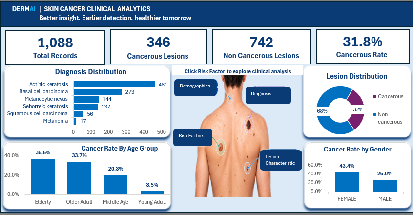
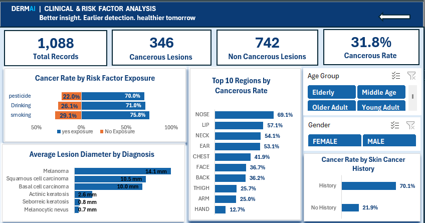

# DermAI Diagnostics — Skin Cancer Clinical & Risk Factor Analytics

**SQL · Excel · Healthcare Analytics**  
*Supporting preparation: Python*

> **Project focus:** An exploratory, stakeholder-facing analysis of skin lesion records. This project does **not** diagnose cancer, estimate population prevalence, or establish causal risk factors.

## 1. Introduction

DermAI Diagnostics explores how cancerous lesion classifications vary across patient demographics, diagnostic categories, anatomical locations and recorded exposures. The goal was to turn clinical records into a consistent, understandable reporting experience rather than produce a predictive model.

I used SQL to inspect and validate records, examine joins and cohort definitions, and prepare an analytical view. Python notebooks supported exploratory analysis, preprocessing and feature engineering. I then used Excel to build two interactive dashboards for stakeholder exploration.

## 2. The Business Problem

Clinical information can be spread across related tables and difficult to compare consistently. Without a defined cohort, validated outcome indicators and accessible reporting, analysts risk producing inconsistent subgroup rates or repeating manual calculations.

The business need was a **traceable view of lesion classifications and associated clinical patterns** that stakeholders could navigate without writing SQL.

## 3. Central Business Question

**How do patient demographics, clinical characteristics and recorded risk factors relate to cancerous skin lesions in this dataset, and which patterns merit further investigation?**

Supporting questions:

- What proportion of analysed lesions is classified as cancerous?
- How do cancerous lesion rates differ by age group and gender?
- How do lesion diameter and anatomical region vary across the clinical records?
- What differences appear between recorded exposure groups and between those with and without skin cancer history?
- How can the findings be presented consistently and interactively for stakeholder review?

## 4. Why This Approach?

I chose **SQL** for the preparation layer because relationships, data quality checks and clinical outcome definitions should be explicit and inspectable. I chose **Excel** for the reporting layer because PivotTables, slicers and charts make subgroup comparisons accessible to non-technical reviewers.

Python supported intermediate exploration and preparation; it was not used to deliver a deployed predictive model. This is presented primarily as a **SQL + Excel data analyst project**, with that supporting work disclosed for transparency.

**Workflow:** SQL retrieval and validation → joins and cohort analysis → analytical view → supporting preparation → Excel analysis → interactive dashboards → recommendations.

## 5. How I Built It

### SQL preparation

- [Database validation](sql/01_database_validation.sql): inspected records and checked data-quality issues.
- [Business analysis](sql/02_business_analysis.sql): investigated joins, cohort definitions and clinical indicators.
- [Analytical view](sql/03_analytical_view.sql): organised fields for downstream analysis.

The central outcome indicator, `cancerous_flag`, was used to count records classified as cancerous. The reported rate is:

```text
Cancerous lesion rate = cancerous lesion count / total lesion count × 100
```

**Clinical classification caveat:** The mapping of diagnostic categories to `cancerous_flag` must be checked against the actual SQL and source definitions before publication. In particular, actinic keratosis is generally considered precancerous rather than an invasive cancer.

### Supporting Python preparation

The repository also contains [EDA](Notebooks/01_EDA.ipynb), [preprocessing](Notebooks/02_preprocessing.ipynb), [feature engineering](Notebooks/03_feature_engineering.ipynb) and [model-ready dataset preparation](Notebooks/04_model_ready_dataset.ipynb) notebooks. “Model-ready” describes the prepared data structure; it does **not** mean a model was trained as part of this deliverable.

### Excel reporting

The [Excel workbook](dashboard/EXCEL-DERMAI.xlsx) contains two linked dashboard pages with KPIs, PivotTable-based summaries, charts and Gender/Age Group slicers.

**Executive Overview** — high-level lesion counts, diagnosis distribution and demographic rates.



**Clinical & Risk Factor Analysis** — exposure comparisons, lesion diameter, anatomical regions and recorded skin cancer history.



*Image paths above are relative to the repository root. Add screenshots with these exact lowercase filenames to the `images/` folder for them to render on GitHub.*

## 6. Tools, AI Assistance & Ownership

| Tool | Role |
|---|---|
| SQL / PostgreSQL | Retrieval, validation, joins, cohort analysis and analytical view |
| Excel / Power Query | Data preparation, PivotTables, KPI calculations, charts, slicers and dashboard navigation |
| Python | Supporting EDA, preprocessing and feature engineering |
| VS Code | Development and project organisation |
| GitHub | Source files, documentation and portfolio presentation |
| ChatGPT | Explanations, troubleshooting and writing support |

I used AI assistance to understand technical options, troubleshoot Excel behaviour and improve documentation. I remained responsible for checking calculations, testing interactions and ensuring that interpretations matched the data. AI suggestions are not treated as independent verification.

## 7. Verification: How I Checked the Results

### Overall KPI reconciliation

| Check | Calculation | Result |
|---|---|---|
| Lesion totals | 346 cancerous + 742 non-cancerous | **1,088** |
| Cancerous rate | 346 ÷ 1,088 × 100 | **31.8%** (rounded) |

### Gender filter reconciliation

| KPI | Female | Male | Combined |
|---|---:|---:|---:|
| Total lesions | 362 | 726 | 1,088 |
| Cancerous lesions | 157 | 189 | 346 |
| Non-cancerous lesions | 205 | 537 | 742 |
| Cancerous rate | 43.4% | 26.0% | 31.8% overall |

I tested the KPI cards against Gender and Age Group selections and confirmed that the relevant charts responded to the connected slicers. I also tested navigation between the two dashboards.

**Scope of verification:** These checks establish internal numerical consistency for the observed outputs and confirm the tested interactions. They do **not** independently validate every source diagnosis, join or outcome mapping. Before describing SQL validation as fully passed, the script outputs should be checked against the final analysis-ready dataset, including record grain, duplicate handling and subgroup denominators.

## 8. Key Clinical Findings

### Overall profile and diagnosis distribution

The dataset contains **1,088 lesion records**, of which **346 (31.8%)** are classified as cancerous and **742 (68.2%)** as non-cancerous. The largest displayed diagnostic categories were actinic keratosis (**461**) and basal cell carcinoma (**273**) records. These are counts within the analysed dataset, not population estimates.

### Age group

| Age group | Cancerous lesion rate |
|---|---:|
| Elderly | 36.6% |
| Older Adult | 33.7% |
| Middle Age | 20.3% |
| Young Adult | 3.5% |

The elderly group had a rate **33.1 percentage points** above the young adult group. Group sizes and selection effects need checking before interpreting the difference further.

### Gender

Female records showed **43.4%** cancerous lesions versus **26.0%** for male records, a **17.4-percentage-point** difference. Male records nonetheless contributed more cancerous lesions in absolute terms (**189 versus 157**). This is why counts and rates should be shown together.

### Average lesion diameter by diagnosis

| Diagnosis | Average diameter |
|---|---:|
| Melanoma | 14.1 mm |
| Squamous cell carcinoma | 10.5 mm |
| Basal cell carcinoma | 10.0 mm |
| Actinic keratosis | 2.6 mm |
| Seborrheic keratosis | 0.8 mm |
| Melanocytic nevus | 0.7 mm |

Melanoma had the largest average recorded diameter among the displayed diagnoses. **Diameter alone is not diagnostic.**

### Anatomical region

The five highest displayed cancerous lesion rates were **nose 69.1%**, **lip 57.1%**, **neck 54.1%**, **ear 53.1%** and **chest 41.9%**. These percentages should be assessed alongside the number of lesions per site.

### Recorded exposures

| Recorded exposure | Exposed | Not exposed |
|---|---:|---:|
| Smoking | 75.8% | 29.1% |
| Alcohol consumption | 71.0% | 26.1% |
| Pesticides | 70.0% | 22.0% |

The exposed groups had higher observed cancerous lesion rates in this dataset. These are **unadjusted descriptive associations**, not evidence that the exposures caused cancer.

### Recorded skin cancer history

The displayed cancerous lesion rate was **70.1%** among records with a history and **21.9%** among those without, a **48.2-percentage-point** difference. The interpretation depends on the definition and completeness of the history field and the sampling process.

## 9. Recommendations & Business Impact

| Finding | Recommended next action | Potential stakeholder value |
|---|---|---|
| Age and gender differences | Review subgroup counts and assess potential confounding | More reliable demographic comparisons |
| Variation by anatomical region | Report denominators and investigate unusually high rates | Better-targeted analytical review |
| Exposure-group differences | Validate exposure definitions and pursue adjusted analysis where appropriate | Stronger evidence before intervention decisions |
| Skin cancer history association | Check history completeness and case-selection effects | Better interpretation of clinical context |
| Repeated clinical reporting needs | Standardise SQL definitions and maintain interactive Excel reporting | Less repeated manual analysis and more consistent KPIs |

**What the project already demonstrates:** A working, interactive reporting workflow; consistent overall and tested Gender KPI arithmetic; and navigation between the two dashboards.

**What is not yet measured:** Time saved, cost reduction, clinical outcome improvement or operational productivity gains. Those would require comparison with an existing reporting process.

If adopted in a real service, I would measure report preparation time, frequency of manual recalculation, source-to-report discrepancies, time to answer common stakeholder questions and data-quality exceptions. These metrics would establish whether the workflow creates quantifiable business value.

## 10. Limitations & Future Improvements

- **Representativeness:** The 1,088 records may not reflect a broader population; rates are not incidence or prevalence estimates.
- **Clinical classification:** Verify the `cancerous_flag` mapping, especially distinctions between malignant and precancerous diagnoses.
- **Uncertainty:** Add subgroup counts and confidence intervals, particularly for small groups.
- **Confounding:** Descriptive exposure differences are not adjusted causal estimates.
- **Data provenance and quality:** Document source, collection context, missingness and join assumptions.
- **Operational evaluation:** Benchmark dashboard reporting against a manual baseline before claiming efficiency gains.

Next improvements would be a published data dictionary, explicit cohort and outcome definitions, reproducible SQL-to-Excel reconciliation checks, subgroup denominators and an evaluation of reporting efficiency.

## 11. Conclusion

DermAI Diagnostics demonstrates how **SQL and Excel** can turn clinical records into an accessible, auditable analytical report. I combined database-level preparation with interactive dashboards to explore lesion classifications, demographic variation, clinical characteristics and recorded exposures.

The project's value is not automated diagnosis. It is a **clearer, traceable way to examine clinical patterns and identify questions worth investigating further**, with the limitations of descriptive analysis made explicit.

## Repository Guide

```text
DermAI_Diagnostics/
├── sql/
│   ├── 01_database_validation.sql
│   ├── 02_business_analysis.sql
│   └── 03_analytical_view.sql
├── Notebooks/
│   ├── 01_EDA.ipynb
│   ├── 02_preprocessing.ipynb
│   ├── 03_feature_engineering.ipynb
│   └── 04_model_ready_dataset.ipynb
├── data/
│   ├── raw/
│   └── processed/
├── dashboard/
│   └── EXCEL-DERMAI.xlsx
├── images/
│   ├── executive_overview.png
│   └── clinical_risk_analysis.png
├── reports/
│   └── clinical_findings_and_recommendations.pdf  
├── requirements.txt
└── README.md
```

